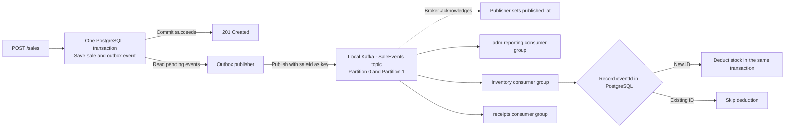

# System Design Labs

Hands-on system design exercises built with Java 21 and Spring Boot. The labs use API requests, application logs, SQL queries, and design diagrams to explore backend patterns.

## Labs

| Lab | What it demonstrates |
| --- | --- |
| Redis cache-aside | Cache product reads for 25–35 seconds with `@Cacheable`. Compare a cache miss, a cache hit, and a read after expiration. |
| Redis cache invalidation | Update a product in PostgreSQL and remove its cached copy with `@CacheEvict`. The next read fetches and caches the updated product. (Lab 2) |
| Redis cache refresh | Update PostgreSQL and replace the cached product with `@CachePut`. The next read gets the updated value from Redis. (Lab 3, current implementation) |
| Redis cache stampede prevention | Use `@Cacheable(sync = true)` with a locking Redis writer. In a test with 10 concurrent requests for the same uncached product, PostgreSQL queries dropped from 10 to 1. |
| Redis negative caching | Cache missing products for 25–35 seconds. Repeat requests return `404` without another PostgreSQL query. |
| Redis TTL jitter | Vary the 30-second base TTL by up to five seconds in either direction. This spreads out expirations and helps reduce database load spikes. |
| Redis rate limiting | Allow five product GET requests per client in a 60-second window. Redis runs a Lua script to update the counter and expiration atomically. |
| Lab 1 — PostgreSQL monthly partitioning | Route kiosk transactions into monthly partitions by sale date. |
| Lab 2 — Read replicas | Design exercise on offloading ADM reports and understanding replica lag. |
| Lab 3 — Location-based sharding | Design exercise on routing kiosk writes and combining report totals. |
| Kafka Lab 1 — Kiosk sales with an outbox | Publish sale events to independent consumer groups and verify recovery after a Kafka outage. |
| Kafka Lab 2 — Idempotent inventory consumer | Replay a sale event and verify that stock is deducted once. |

## Lab 1 — Partitioning kiosk transactions by month

**Partitioning** splits one logical table into smaller parts. PostgreSQL routes each sale by `transaction_date`.

```text
Insert sale into kiosk_transactions
  ├── January  → kiosk_transactions_jan
  └── February → kiosk_transactions_feb
```

**Why it helps.** A January report can skip February. This is called **partition pruning**.

**ADM reports.** Query the parent table with a date filter. PostgreSQL chooses which partitions to scan.

Run [monthly-sales.sql](labs/partitioning/monthly-sales.sql) from the project root in PowerShell with Docker Desktop running.

```powershell
docker compose up -d postgres
Get-Content -Raw .\labs\partitioning\monthly-sales.sql | docker compose exec -T postgres psql -X -v ON_ERROR_STOP=1 -U lab -d products
```

The script inserts four sales. The January partition query returns January 10 (20.00) and January 31 (30.00).

## Lab 2 — Replication for kiosk sales reporting

**Replication** maintains a copy of the primary database on another server. A **read replica** serves read queries using that copy.

```text
Kiosk checkout   → Primary database → Saves sales
                   Primary database → Copies changes to read replica
ADM sales report → Read replica     → Reads sales
```

**Why it helps.** Running reports on the replica leaves more capacity on the primary for checkout writes.

**ADM reports.** A new sale may take a moment to appear. This delay is called **replication lag**.

## Lab 3 — Sharding kiosk transactions by location

**Sharding** distributes transactions across database servers. In this example, `location_id` is the **shard key**. It tells the application where to save each sale.

```text
Locations A and B → Shard 1 → Saves their transactions
Locations C and D → Shard 2 → Saves their transactions
```

**Why it helps.** Checkout writes and storage are spread across servers. A very busy location can still overload its shard.

**ADM reports.** A report for Location A reads from Shard 1. A report for all locations reads both shards and combines their totals. This is called **scatter-gather**.

## Kafka Lab 1 — Kiosk sales with a transactional outbox

Checkout saves the sale in `kiosk_sales` and its `SaleCompleted` event in `kiosk_sale_outbox` in one PostgreSQL transaction. The outbox publisher sends pending events to local Kafka using `saleId` as the key. It sets `published_at` after Kafka acknowledges the send.



Each event lands in one partition. Each consumer group tracks its own offset per partition. ADM reporting and email or SMS delivery are simulated with logs. The inventory consumer updates stock in PostgreSQL.

### Run the demo

```powershell
docker compose up -d postgres redis kafka
.\mvnw.cmd spring-boot:run
```

Send **POST http://localhost:8080/sales** in Bruno with a JSON body.

```json
{
  "amount": 20.00,
  "itemSku": "SANDWICH",
  "receiptType": "EMAIL"
}
```

1. **Fan-out.** Expect `201 Created` with a `saleId`. All three consumers log the same sale, partition, and offset.
2. **Receipt catch-up.** Send `POST /kafka-demo/receipts/stop`, then submit another sale. ADM and inventory still log it. Send `POST /kafka-demo/receipts/start` and verify receipts logs the missed sale.
3. **Outbox recovery.** Keep Spring Boot and PostgreSQL running. Run `docker compose stop kafka` and submit a sale. It returns `201` and its outbox row has a blank `published_at`. Run `docker compose start kafka` and check again. The same outbox row now has a timestamp.

Run this query before and after restarting Kafka. Replace `<saleId>` with the ID returned by checkout.

```powershell
docker compose exec postgres psql -U lab -d products -c "SELECT sale_id, event_id, published_at FROM kiosk_sale_outbox WHERE sale_id = '<saleId>';"
```

## Kafka Lab 2 — Idempotent inventory consumer

The inventory consumer records the `eventId` in `kiosk_inventory_processed_events` and deducts one item from `kiosk_inventory` in one PostgreSQL transaction. An existing event ID skips the deduction. A failed deduction rolls back the event ID insert so a retry can still apply it.

Submit a `SANDWICH` sale using the Lab 1 request and wait for `STOCK_DEDUCTED`. Copy the returned sale ID. In PowerShell, republish its original outbox payload to keep the same `eventId` and Kafka key.

```powershell
$saleId = '<saleId>'
$payload = docker compose exec -T postgres psql -U lab -d products -At -c "SELECT payload::text FROM kiosk_sale_outbox WHERE sale_id = '$saleId';"
if ($LASTEXITCODE -ne 0 -or -not $payload) { throw 'Could not read the outbox event.' }
"${saleId}:$payload" | docker compose exec -T kafka /opt/kafka/bin/kafka-console-producer.sh --bootstrap-server localhost:9092 --topic SaleEvents --property parse.key=true --property key.separator=:
```

Expect `DUPLICATE_SKIPPED` for the same event ID at a new offset. Starting from the seed quantity of 10, the first delivery leaves 9 and the replay leaves 9. Check stock before and after replay.

```powershell
docker compose exec postgres psql -U lab -d products -c "SELECT item_sku, quantity FROM kiosk_inventory WHERE item_sku = 'SANDWICH';"
```

## Redis and PostgreSQL

PostgreSQL stores the product records. Redis stores temporary copies keyed by product ID. On a cache miss, Spring Boot uses `JdbcTemplate` to query PostgreSQL and caches the result in Redis. The current PUT flow uses `@CachePut` to store the updated product in Redis after PostgreSQL updates the row. Each cache write gets a fresh TTL of 25–35 seconds. A missing product returns `404 Not Found`.

## Run locally

Install Java 21 and start Docker Desktop. From the project root, start PostgreSQL and Redis, then launch Spring Boot.

```powershell
docker compose up -d
docker compose ps
.\mvnw.cmd spring-boot:run
```

The API runs at `http://localhost:8080`. On startup, Spring Boot creates the products table and seeds product `123` with the name **Mechanical Keyboard** on a fresh database.

## Try it in Bruno

Use `http://localhost:8080/products/123` for both requests. For GET, set `X-Client-Id` to a fresh test value in Bruno. Send PUT with a JSON body such as `{"name":"Wireless Keyboard"}`. Choose a different name from the current one so the change is visible.

| Request | Expected result |
| --- | --- |
| GET with an empty cache | `200 OK` with the product. The log shows a cache miss and a SQL SELECT. |
| Repeat GET within 25 seconds | Same product with no new SQL SELECT. |
| PUT within 25 seconds of filling the cache | `204 No Content`. The app updates PostgreSQL and refreshes the Redis entry. |
| GET immediately after PUT | `200 OK` with the new name and no new SQL SELECT. |
| Repeat GET within 25 seconds | The updated product comes from Redis. |

To test expiration separately, wait more than 35 seconds after a cache fill, then send another GET. It should query PostgreSQL again.

### Test the rate limit

Send six GET requests within 60 seconds using the same fresh `X-Client-Id`. The first five return `200 OK`. The sixth returns `429 Too Many Requests` with a `Retry-After` header in seconds.

Send a GET with a different client ID to verify that it has its own counter. The original client can send requests again after its window expires. A GET without the client header returns `400 Bad Request`. The header simulates client identity for this lab.
